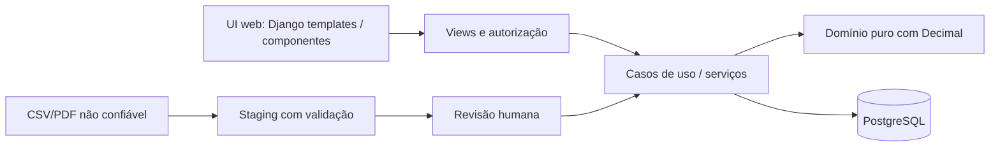

# Arquitetura — monólito modular orientado a domínio

**Decisão:** preferir um único deploy Django/PostgreSQL (monólito modular) até haver evidências de necessidade de serviços distribuídos. Menos complexidade operacional e transações financeiras confiáveis no mesmo banco.

## Responsabilidades

- `apps/core`: autenticação, primeiro cadastro, usuários, permissões, logs e healthchecks.
- `apps/finance/models.py`: entidades, integridade de banco, relações e checks.
- `apps/finance/domain`: cálculos puros e invariantes, sem dependência de ORM para facilitar testes e mudança de armazenamento.
- `apps/finance/services`: casos de uso coordenando transação, locking e trilhas de auditoria. **Não** editar `BankAccount.balance` diretamente em views.
- `config/settings.py`: variáveis de ambiente, proibir segredos hardcoded, sem assumptions de hostname.
- `docs/prototype`: apresentação legada congelada, não fontes ativas do Django.
- `templates/finance` e `static/finance`: shell Claro/Escuro, cinco destinos, ícones e parciais de histórico, metas e importação. JavaScript abre formulários renderizados pelo servidor em diálogos; o envio continua submetido às views.
- `apps/finance/services/metrics.py`: read model autorizado pela view para o anel mensal e históricos confirmados, sem persistir projeções nem transformar `NULL` em zero.
- `docs/SPEC_ORIGINAL_COMPLETA.md`: histórico integral; decisões novas em ADRs + changelog. Se requisitos conflitarem, prevalece ADR aprovado mais recente.

## Escalabilidade e mutabilidade segura

- Evoluir por módulos de domínio, não microserviços prematuros; definir portas de serviço estáveis.
- Preferir **migrações expand/contract**: adicionar colunas, migrar dados em lote idempotente e só depois remover campo obsoleto em release separado.
- Mudanças em cálculos: testes de invariantes, snapshots auditáveis, sem alterar retroativamente ledger já confirmado.
- Adaptadores CSV, OFX e PDF estão em `apps/finance/services/importers.py`; o staging e commit ficam em `apps/finance/services/imports.py`.
- No ZimaOS, proteger volumes e restauração antes de upgrade. Compose é infraestrutura, não arquivo para colocar senhas em Git.
- Regras de permissão por núcleo/usuário/perfil aplicadas **em cada service/view**, não apenas ocultando botões no navegador. A autorização por workspace, perfil e objeto está em `apps.core.permissions` e nas views/serviços financeiros; mutações do Django Admin financeiro ficam bloqueadas. Grants por módulo (`none/view/edit`) já existem.

O fluxo e os riscos verificados nesta auditoria estão em `docs/reviews/ALECE_REVISAO_ARQUITETURA.md`.

## Segurança e disponibilidade

- Serviços em rede Docker isolada; PostgreSQL sem publish de porta.
- Início de web condicionado ao `pg_isready`; saúde de prontidão valida conexão SQL.
- Django Gunicorn, cookies seguros quando HTTPS habilitado, CSRF middleware presente.
- Logs de intervenção ficam no `$HOME/logs`, backups em `$HOME/backups`, verificados por SHA-256. Volume de banco deve persistir mesmo se web for substituída.
- TLS é essencial ao expor login fora do loopback; em laboratório/local LAN usar controles de rede e decisão de risco consciente, não desativar proteções da plataforma por conveniência.
